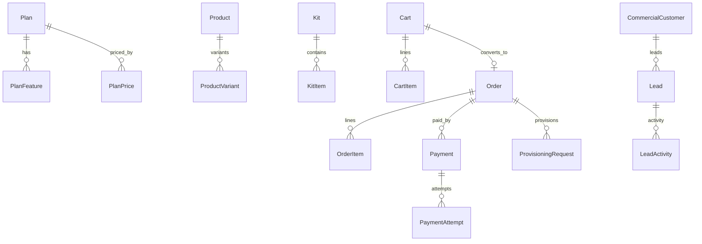

# Data model — commercial PostgreSQL

Source of truth: `packages/database/prisma/schema.prisma`.  
Money fields use **integer minor units** (`amountCents`); never floating-point COP.

## Core domains

## Entity groups

| Group | Models (selection) | Notes |
| --- | --- | --- |
| CRM | `CommercialCustomer`, `BusinessProfile`, `Lead`, `LeadActivity`, `ContactRequest`, `DemoRequest` | Portal-owned leads; not POS operator tables |
| Catalog | `Plan`, `PlanFeature`, `PlanPrice`, `LicenseOffering`, `Product*`, `Kit*` | `PlanFeature.commercialStatus` drives honesty badges |
| Commerce | `Cart`, `CartItem`, `Order`, `OrderItem`, `Coupon*`, `Promotion`, `Benefit*` | Cart → checkout → order |
| Payments | `Payment`, `PaymentAttempt`, `PaymentEvent` | Factus Pay adapter + webhook events |
| Fulfillment | `ProvisioningRequest`, `Shipment` | Provisioning targets Central; hardware ships separately |
| Content / SEO | `BlogPost`, `Faq`, `SeoMetadata`, `MediaAsset`, `SiteSettings` | CMS-ish content for the site |
| Coverage | `Department`, `City`, `CoverageZone`, `ShippingRate` | Colombia coverage pages |
| Trust / legal | `ConsentRecord`, `LegalDocument`, `AuditLog`, `SupportTicket*` | Append-oriented audit for admin actions |
| Outbox | `NotificationOutbox` | Async notification intent |

## Feature commercial status

Enum `FeatureCommercialStatus`: `AVAILABLE` | `IN_CERTIFICATION` | `COMING_SOON` | `UNPUBLISHED`.

Commercial UI must surface these statuses; **do not** upgrade a claim without evidence from the POS product line or an authorized decision.

## Migrations

Physical migrations live under `packages/database/prisma/migrations/`.  
Apply with `pnpm prisma:migrate:deploy` (CI validates schema via `prisma validate`).
