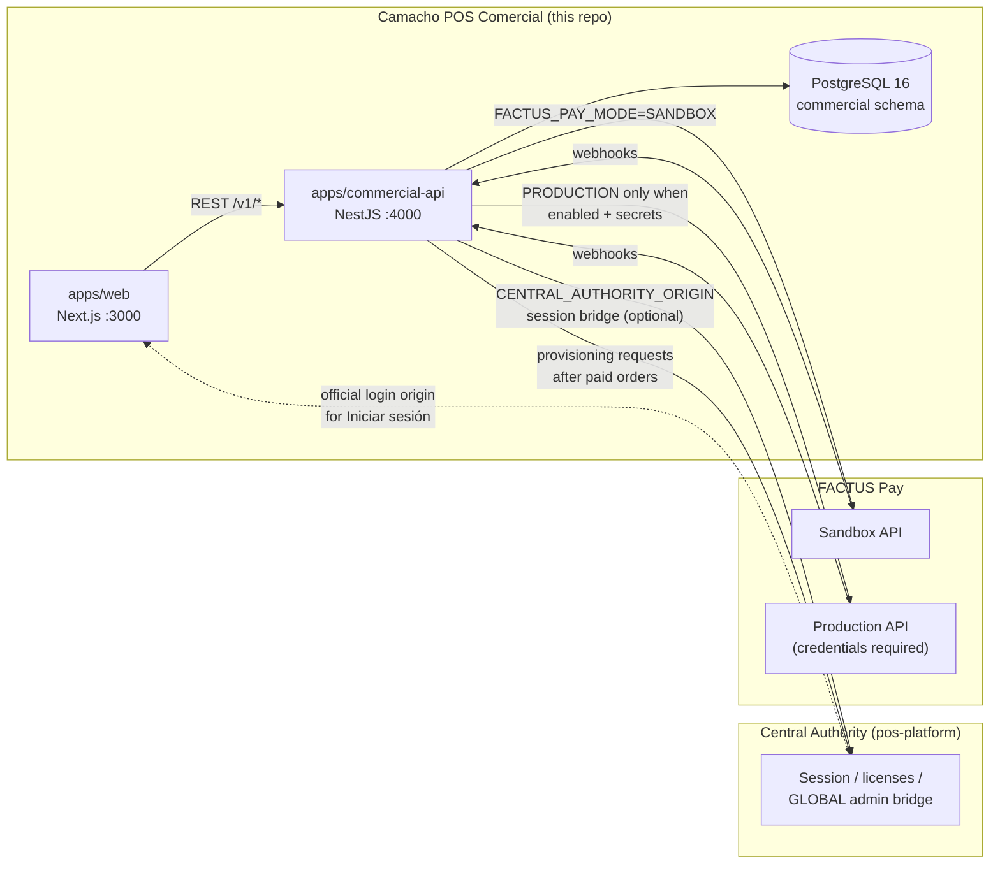

# Architecture overview — commercial platform

Camacho POS Comercial is an **independent commercial portal**: public website, catalog, cart/checkout, CRM leads, and license/hardware sales orchestration. It is **not** a duplicate of the POS product runtime (`pos-platform`).

## Relationship diagram

## Boundaries

| System | Owns | Does not own |
| --- | --- | --- |
| Portal web + API | Marketing pages, commercial catalog, carts, orders, Factus Pay *collection for portal sales*, leads, support tickets in commercial DB | POS caja, local SQLite, DIAN domain rules, store inventory truth |
| Central Authority | Official operator identity, licenses after hire/provision, GLOBAL admin | Public marketing CMS |
| FACTUS Pay | Payment collection for commercial checkout (adapter) | Product catalog or POS fiscal documents |

## Runtime ports (local / compose)

| Service | Port |
| --- | --- |
| web | 3000 |
| commercial-api | 4000 |
| postgres (compose host map) | **5433** → container 5432 |

## Fail-closed notes

- Production Factus credentials missing → refuse production payment mode.
- WhatsApp `DEV_PLACEHOLDER` → forbidden when `NODE_ENV=production`.
- Web production runtime does not invent sellable catalog when API is down (draft fallback is for development / build only).
